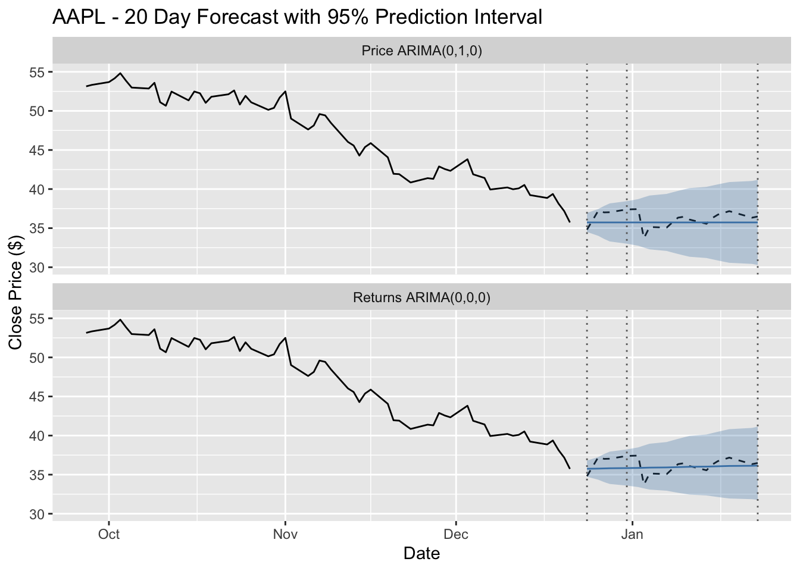
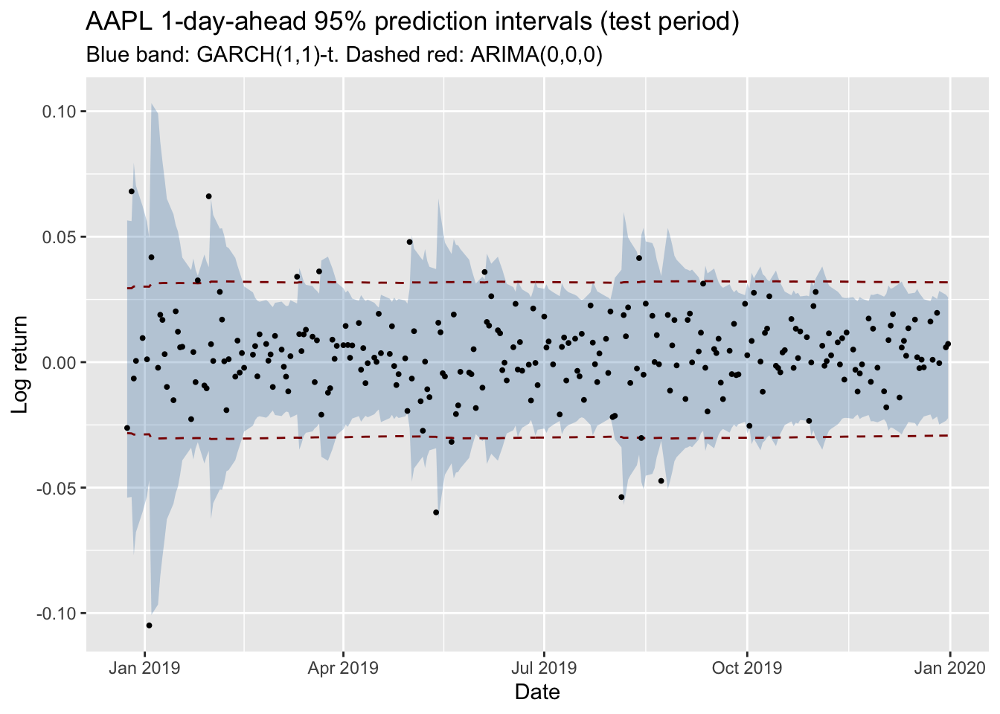
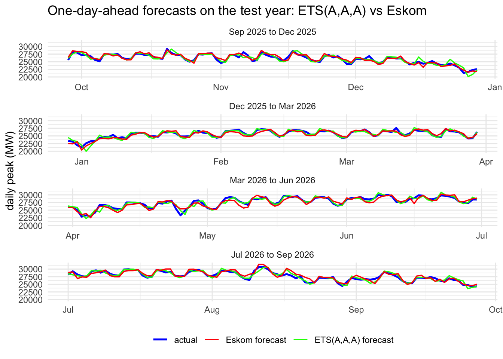
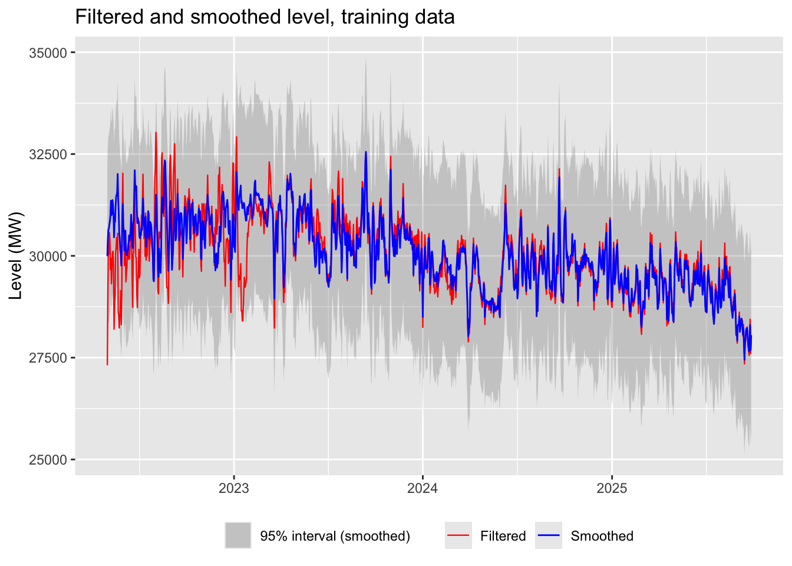

This site displays my portfolio for Time Series Analysis 2026. It is set out so that you can step through it in order and follow the work I have put together to show my understanding of the concepts and techniques covered in this course. I hope you enjoy it.

::: {.grid .stats-row}
::: {.g-col-6 .g-col-md-3 .stat}
[4]{.num} projects
:::
::: {.g-col-6 .g-col-md-3 .stat}
[2]{.num} data sets
:::
::: {.g-col-6 .g-col-md-3 .stat}
[5]{.num} tutorials
:::
::: {.g-col-6 .g-col-md-3 .stat}
[9]{.num} journal entries
:::
:::

## Projects

::: {.grid}
::: {.g-col-12 .g-col-md-6 .home-card}

### [Project 1: ARIMA on AAPL](projects/project-01-financial-forecasting/project-01.qmd)
Can AR, MA and ARIMA models forecast Apple's daily price and log returns 1, 5 and 20 days ahead?

[ARIMA]{.tag} [Cross-validation]{.tag} [AAPL]{.tag}
:::

::: {.g-col-12 .g-col-md-6 .home-card}

### [Project 2: GARCH on AAPL](projects/project-02-garch-volatility/project-02.qmd)
Does a GARCH(1,1) model remove the volatility clustering left by ARIMA, and give better prediction intervals?

[ARCH and GARCH]{.tag} [Volatility]{.tag} [AAPL]{.tag}
:::

::: {.g-col-12 .g-col-md-6 .home-card}

### [Project 3: ETS vs regression on Eskom](projects/project-03-eskom-demand/project-03.qmd)
Exponential smoothing against time series regression on daily peak demand, with Eskom's own forecast as the benchmark.

[Exponential smoothing]{.tag} [Regression]{.tag} [Eskom]{.tag}
:::

::: {.g-col-12 .g-col-md-6 .home-card}

### [Project 4: Kalman filter on Eskom](projects/project-04-state-space/project-04.qmd)
A Kalman filter written from scratch, with a moving level and calendar effects, on the same Eskom data.

[State space]{.tag} [Kalman filter]{.tag} [Eskom]{.tag}
:::
:::

## Where to start

::: {.grid}
::: {.g-col-12 .g-col-md-3 .home-card .small-card}
### [Journal](journal/index.qmd)
What I learnt in each topic and practical, and what I struggled with.
:::
::: {.g-col-12 .g-col-md-3 .home-card .small-card}
### [Tutorials](section-1/index.qmd)
Short worked tutorials for [Section 1](section-1/index.qmd) and [Section 2](section-2/index.qmd).
:::
::: {.g-col-12 .g-col-md-3 .home-card .small-card}
### [Reflective Commentary](reflective-commentary.qmd)
Looking back on the course, with the [AI Use Log](ai-use-log.qmd) and [References](references.qmd).
:::
::: {.g-col-12 .g-col-md-3 .home-card .small-card}
### [Appendix](appendix/code-and-data.qmd)
Where the code and data come from, and how to reproduce every page.
:::
:::
